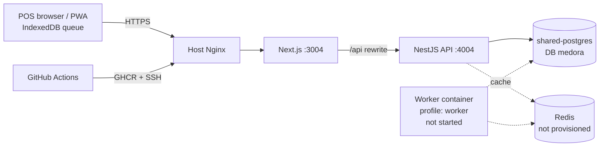

# Pharmacy Management ("Medora") — Architecture Inventory

Audited commit: `e5c9900` (main, 2026-11-13). 122 tracked files. Static evidence from source.

## 1. Repository layout

| Path | Contents |
|---|---|
| `backend/` | NestJS API (`src/`), Prisma 7 schema + 3 migrations, seed, tests, `infra/docker-compose.yml` (dev Postgres/Redis), `scripts/`, docs, **inactive** CI at `backend/automation/github/workflows/ci.yml` |
| `frontend/` | Next.js app with PWA manifest, service worker, IndexedDB offline queue, Playwright specs |
| `deploy/` | Production compose, env template, README |
| `.github/workflows/deploy.yml` | Build → GHCR → SSH deploy on push to `main` |
| `.gitignore` (root) | Attacker-added remnant (`config.bat`, `node_modules`) |

## 2. Technology inventory

| Layer | Technology |
|---|---|
| Runtime | Docker `node:24-alpine`. Prisma 7.10 requires Node `^20.19 || ^22.12 || >=24`; `backend/package.json` declares no `engines` |
| API | NestJS 11, Express; `bodyParser` replaced with `express.json({limit: "3mb"})` |
| ORM / DB | Prisma 7 with `@prisma/adapter-pg`, `prisma.config.ts`; PostgreSQL |
| Validation | zod (`backend/src/common/validation.ts`) |
| Auth | JWT (HS256, 8 h, issuer/audience) in an httpOnly `session` cookie, `SameSite=Strict`; scrypt password hashing (`backend/src/auth/password.ts`); global `AuthGuard` with `@Public()` / `@Roles()` |
| CSRF | Origin allowlist + required `X-Pharmacy-Client: web` header on non-GET (`backend/src/auth/auth.ts:50-59`) |
| Cache | ioredis barcode cache with Postgres fallback (`catalog/barcode-cache.service.ts`) |
| Jobs | BullMQ worker as a separate process (`src/jobs/worker.ts`), hourly `maintenance()` |
| Realtime | Server-Sent Events polling the audit table every 5 s per client (`events/events.controller.ts`) |
| Frontend | Next.js App Router (standalone), React, plain CSS (2,086 lines), `idb`, `lucide-react`; service worker `public/sw.js` |
| Tests | `node:test` on compiled output (`npm test` = `tsc` + `node --test dist/test/*.test.js`); Playwright |

## 3. Backend modules

One `AppModule` (`backend/src/app.module.ts`), 19 controllers, 4 services.

| Folder | Controllers / services | Responsibility |
|---|---|---|
| `auth/` | `AuthController`, `AuthGuard`, `password.ts` | Login, me, logout, change password, role guard |
| `catalog/` | `CatalogController`, `BarcodeCache` | Medicines, generics, CSV import, barcode lookup |
| `inventory/` | `InventoryController`, `InventoryService` | Batches, FEFO allocation, cycle-count adjustment, movements |
| `sales/` | `SalesController`, `SalesService` | POS checkout (the core transaction) |
| `sync/` | `SyncController` | Offline sale push and review queue |
| `purchasing/` | `PurchasingController` | Suppliers, purchase orders, goods receipt, purchase return |
| `returns/` | `ReturnsController` | Customer return request and approval |
| `recalls/` | `RecallsController` | Lot recall, buyer trace, waste |
| `prescriptions/` | `PrescriptionsController` | Capture, verify, cancel, image, refill |
| `alerts/` | `AlertsController` | Alert list and resolve |
| `reports/` | `ReportsController` | Dashboard, expiry ageing, sales/margin, controlled register, audit |
| `settings/` | `SettingsController` | Shop settings, owner PIN, users |
| `events/` | `EventsController` | SSE refresh signal |
| `operations/` | `CustomersController`, `FinanceController` + `FinanceService`, `StockControlController`, `FulfillmentController`, `IntelligenceController` | Customer credit and loyalty, register shifts, expenses, supplier bills, locations, transfers, cold-chain sensors, deliveries, refill reminders, replenishment |
| `jobs/` | `maintenance.ts`, `worker.ts` | Expiry quarantine, low-stock and expiry alerts, controlled-drug snapshot |
| `common/` | `domain.ts`, `validation.ts`, `audit.ts`, `error.filter.ts` | FEFO planner, money, dates, audit writer |
| `db/` | `Db` | Prisma client with `atomic()` (Serializable + retry) |
| `integrations/` | `hl7.ts` | Interface only; no hospital integration |

## 4. API inventory (no global prefix; reached through the Next `/api/*` rewrite)

| Area | Routes |
|---|---|
| Auth | `POST auth/login`, `GET auth/me`, `POST auth/logout`, `POST auth/password` |
| Catalog | `GET catalog`, `GET catalog/barcode/:barcode`, `GET catalog/generics`, `POST catalog`, `PATCH catalog/:id`, `POST catalog/import` |
| Inventory | `GET inventory`, `POST inventory/allocate-preview`, `POST inventory/:id/adjust`, `GET inventory/:id/movements` |
| POS | `POST pos/sales`, `GET pos/sales` |
| Sync | `POST sync/push`, `GET sync/reviews` |
| Purchasing | `GET/POST purchasing/suppliers`, `GET/POST purchasing/orders`, `POST …/orders/:id/status`, `POST …/orders/:id/receive`, `POST purchasing/returns` |
| Returns / recalls | `GET/POST returns`, `POST returns/:id/review`, `POST recalls`, `GET recalls/:id/customers`, `POST recalls/:id/waste` |
| Prescriptions | `GET/POST prescriptions`, `POST …/:id/verify`, `…/cancel`, `…/refill`, `GET …/:id/image` |
| Customers | `GET/POST customers`, `PATCH customers/:id`, `GET …/:id/statement`, `POST …/:id/payments` |
| Finance | `GET/POST finance/shifts`, `POST …/shifts/:id/close`, `POST …/shifts/:id/movements`, `GET/POST finance/expenses`, `GET/POST finance/bills`, `POST …/bills/:id/payments` |
| Stock control | `GET/POST stock-control/locations`, `GET/POST …/transfers`, `POST …/transfers/:id/:action`, `GET/POST …/sensors`, `POST …/sensors/:id/readings`, `POST …/locations/:id/release`, `POST …/batches/:id/release` |
| Fulfilment | `GET/POST fulfillment/deliveries`, `POST …/deliveries/:id/status`, `GET/POST fulfillment/reminders`, `POST …/reminders/:id/status` |
| Intelligence | `GET intelligence/replenishment`, `POST …/replenishment/orders`, `GET intelligence/summary` |
| Reports | `GET reports/dashboard`, `…/expiry-ageing`, `…/sales`, `…/controlled`, `…/audit` |
| Other | `GET alerts`, `POST alerts/:id/resolve`, `PATCH settings`, `GET/POST settings/users`, `PATCH settings/users/:id`, `GET events` (SSE), `GET health` |

There is **no** registration, shop-creation, plan or billing route.

## 5. Database entities (33 models)

`Shop`, `User` (enum `Role`: OWNER, PHARMACIST, CASHIER, STORE_KEEPER, AUDITOR), `Generic`, `Medicine`, `StockBatch`, `StockLocation`, `StockMovement`, `StockTransfer`, `Supplier`, `PurchaseOrder`, `PurchaseOrderLine`, `GoodsReceiptLine`, `SupplierBill`, `SupplierPayment`, `Prescription`, `PrescriptionItem`, `Sale`, `SaleLine`, `SaleLineBatch`, `SaleReturn`, `Customer`, `CustomerLedger`, `RegisterShift`, `CashMovement`, `Expense`, `Delivery`, `RefillReminder`, `TemperatureSensor`, `TemperatureReading`, `Alert`, `AuditEntry` (immutable by trigger), `SyncReview`.

## 6. Tenancy as implemented

Tenant = `Shop`. Single database, shared schema, `shopId` on root tables. The guard derives `shopId` from the authenticated user's database row. There is no organisation above the shop and no branch entity below it; `StockLocation` models counters/stores inside one shop.

## 7. External integrations

| Integration | Status |
|---|---|
| Payment gateway | None. bKash/Nagad/card are tender **labels** recorded on a sale |
| SMS / email | None |
| Medicine master data | None; each shop enters or imports its own catalogue |
| Barcode scanner | Keyboard-wedge input handled in the POS page |
| Hospital/HL7 | Interface stub only |
| Redis | Optional for barcode cache; required for the maintenance worker; not provisioned in the documented production setup |

## 8. Deployment

Compose project `medora`: `backend` (4004), `frontend` (3004), and a `worker` service behind the compose profile `worker` (not started by `docker compose up -d`). Shared `shared-postgres` on `apps-net`. `sslip.io` hostname. Workflow identical in shape to the event product (migrate after start, no tests).

## 9. Current architecture diagram

