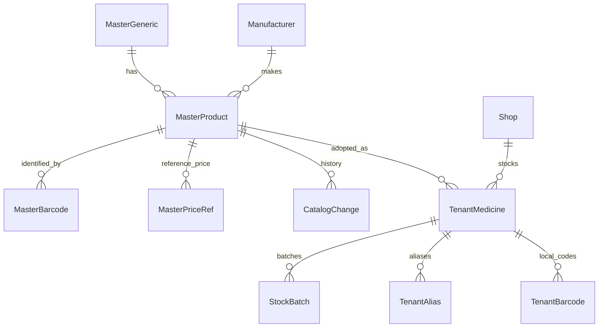

# Pharmacy Management — Bangladesh Medicine Database Research

## 1. What the product has today

- No master catalogue. `Medicine` rows belong to a shop; `Generic` is a global table that tenants fill themselves (`backend/src/catalog/catalog.controller.ts:84-88`).
- Fields: brand name, generic (name, therapeutic class), manufacturer, strength, form, pack size, barcode, schedule (OTC/RX/CONTROLLED), unit name, unit price, reorder level, active.
- Import: CSV up to 500 rows per request (`catalog.controller.ts:124-172`).
- The seed inserts demo medicines; no real dataset is bundled. Nothing in the repository was fabricated from an external source as far as the code shows.

## 2. Research performed in this session

Web searches only; no source was scraped and no dataset was downloaded. Everything below needs confirmation with the source owner before use.

| Source | What was found | Confidence |
|---|---|---|
| Directorate General of Drug Administration (DGDA), `dgda.gov.bd` | Search results describe online services including allopathic and traditional medicine databases and information on registered medicines. A bulk download or public API was **not** found in the results | Low — not confirmed on the DGDA site itself |
| Bangladesh Core FHIR Implementation Guide (`fhir.dghs.gov.bd`) | Publishes a code system named "DGDA drug registry" referencing `dgda.gov.bd/drug-registry`, listed with 39,196 entries and described as maintained in a national terminology collection | Medium that the registry exists in machine-readable form; **unknown** whether it is openly licensed, complete or current |
| MedEx (`medex.com.bd`) | A private medicine information site with brand and generic listings and a downloads section | It is not an official source; its terms of use were not reviewed. Do not copy or scrape without written permission |
| Older DGDA-related presentation | Mentions roughly 1,268 allopathic generics and 23,568 brands | Dated; scale indication only |
| Price data | No authoritative downloadable price list was found | Not available from these searches |
| Barcodes | No public barcode-to-product registry for Bangladeshi medicines was found | Not available |

Sources: [Bangladesh Core FHIR IG — DGDA drug registry code system](https://fhir.dghs.gov.bd/core/CodeSystem-dgda-drug-registry.html), [DGDA registered drugs value set](https://fhir.dghs.gov.bd/core/ValueSet-dgda-registered-drugs.html), [MedEx downloads page](https://medex.com.bd/downloads), [DGDA overview (third-party)](https://www.freyrsolutions.com/what-is-the-directorate-general-of-drug-administration-dgda.md).

## 3. Open questions to resolve (owner action)

1. Ask DGDA in writing whether the registered-product list may be reused commercially, in what format it can be obtained, and how often it changes.
2. Check the licence and terms of the DGHS FHIR terminology content and whether the DGDA registry code system can be downloaded in full.
3. Approach MedEx or similar data owners for a licence (one-time or subscription), including update feeds.
4. Ask two or three large manufacturers or distributors for product lists with pack sizes, MRPs and barcodes; several publish price lists to retailers.
5. Confirm with a pharmacist what identifiers shops actually see on packs (DAR number, barcode presence) so the data model matches reality.

## 4. Compliant approach if no licensed dataset is available

1. **Platform-curated seed:** start with generics (INN names are not proprietary) and therapeutic classes entered by a pharmacist on the team.
2. **Tenant-contributed brands with review:** when a shop adds a brand that is not in the master list, store it as a tenant record and queue it for platform review; approved entries become master records visible to all. No tenant's prices, stock or supplier data are shared.
3. **Verified imports:** accept manufacturer/distributor price lists supplied by the rights holder; record source, date and permission.
4. **Never** bundle scraped content; record provenance for every master row.

## 5. Recommended architecture

| Entity | Key fields | Notes |
|---|---|---|
| `MasterGeneric` | name, therapeuticClass, status | Platform-owned; replaces tenant-writable `Generic` |
| `Manufacturer` | name, licence reference | — |
| `MasterProduct` | brandName, genericId, manufacturerId, strength, dosageForm, packSize, unit, registrationNo (DAR), schedule, active, source, sourceDate | One row per registered presentation |
| `MasterBarcode` | productId, code | Many per product; unique on code within master |
| `MasterPriceRef` | productId, mrpMinor, effectiveFrom, source | Reference only; never overrides a shop's price automatically |
| `CatalogChange` | productId, field, old, new, actor, at | Update history |
| `TenantMedicine` (today's `Medicine`) | shopId, masterProductId (nullable), local overrides, sale price, reorder level, active | A shop can stock an item that is not in the master list |
| `TenantAlias` | medicineId, alias | Local names staff type |
| `TenantBarcode` | shopId, medicineId, code — unique `(shopId, code)` | Shop-printed or missing-from-master codes |
| `StockBatch` | add `mrpMinor` per batch | MRP printed on the pack can differ by batch |

Rules:

- Barcode lookup order: tenant barcode → master barcode mapped to the tenant's adopted product → "not in your list, add from master?".
- Master updates never change tenant stock or prices; they raise a suggestion ("MRP reference changed").
- Deactivating a master product flags tenant copies but does not block selling existing stock.
- The catalogue API for tenants is read-only on master data.

## 6. Data quality and update process

- Assign an owner (a pharmacist) for the master list; weekly review queue of tenant-submitted products.
- Validation: required generic + strength + form; duplicate detection on (brand, strength, form, manufacturer).
- Versioned imports with a dry-run diff before applying.
- Record `source` and `permission` on every row; be able to remove a source's data if a licence ends.

## 7. Effort and sequencing

| Step | Effort |
|---|---|
| Fix per-shop barcode uniqueness; make `Generic` platform-owned | S |
| Master tables + read-only API + "add from master" in catalogue and POS | M |
| Tenant submission and review queue (needs platform admin console) | M |
| Batch-level MRP | S |
| Licensed dataset ingestion pipeline | M, after a licence exists |

A good starter list is a sales tool: "search and tick your medicines" turns a multi-day data-entry job into an hour. It is worth securing a legitimate source before the commercial launch.
